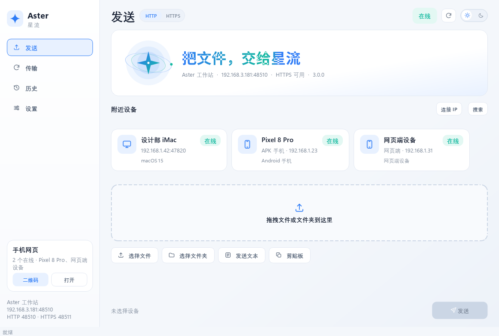
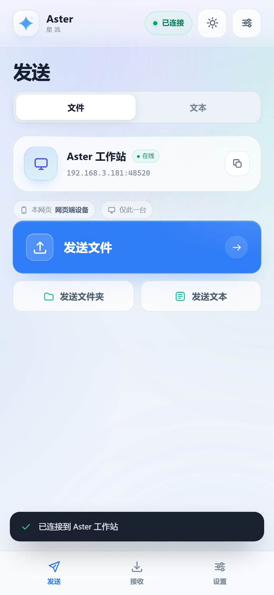
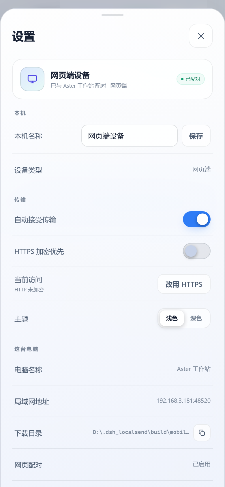
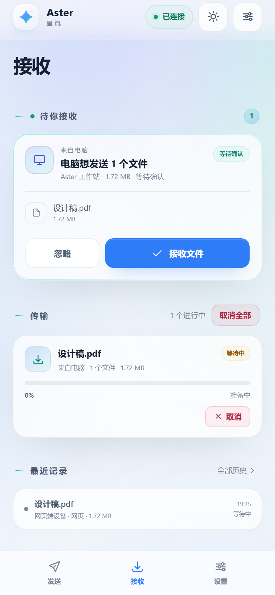
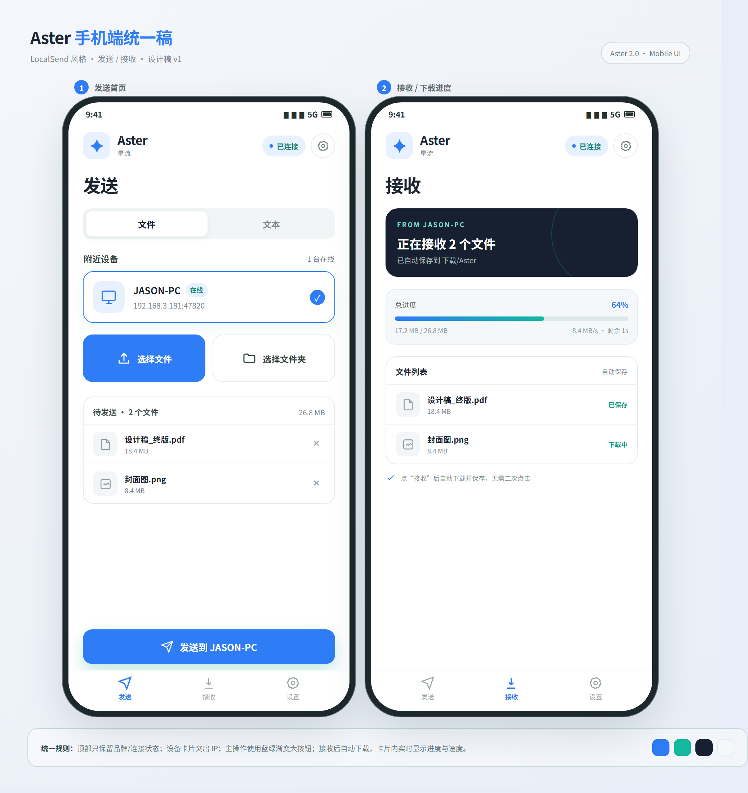

# Aster · 星流 2.0

**局域网文件流转，快而克制。**

Aster 是一个自研局域网文件互传工具，当前只保留两个端：

- **桌面端**：`Aster.exe`，PySide6 原生窗口，内置 HTTP/HTTPS 服务和手机网页。
- **手机端**：电脑托管的网页 + Android WebView APK；扫码连接，上传/接收文件。

> 命令行版已移除。项目不再构建 `AsterCLI.exe`、TUI 或命令行启动脚本。


## 下载

构建产物体积较大，**不提交到仓库**（已写入 [`.gitignore`](.gitignore)），统一发布在 [Releases](https://github.com/JASON-SHEN-0225/Aster/releases/latest)：

| 文件 | 说明 |
|---|---|
| `Aster-Setup-2.0.0.exe` | Windows 安装包，含防火墙规则与资源管理器右键 |
| `Aster.exe` | 免安装桌面端 |
| `Aster-2.0.0-release.apk` | Android APK |
| `SHA256SUMS.txt` | 下载校验值 |

从源码运行或自行打包见 [开发与构建](#开发与构建)。

## 功能

- 电脑 ↔ 电脑、手机 ↔ 电脑文件互传
- 多文件、文件夹、断点续传、SHA-256 校验
- HTTP `47820` / HTTPS `47821` 同时监听
- 自签名 HTTPS，可记住优先协议
- 资源管理器右键 **发送到 Aster**，进入预传输队列
- 接收确认、自动接受、PIN、网页配对码
- 实时速度、进度、平均速度、历史
- 浅色 / 深色主题、托盘、开机自启
- 手机网页：LocalSend 风格布局，与桌面蓝/薄荷配色一致

## 预览

| 桌面端 | 手机端 |
|---|---|
|  |  |

| 手机设置 | 接收 |
|---|---|
|  |  |

### 手机端 LocalSend 风格界面



## 仓库结构

```text
Aster/
├── aster/                 桌面端（GUI、HTTP/HTTPS 服务、协议、TLS、Web UI）
│   ├── gui/               PySide6 窗口、控件与主题
│   └── webui/             手机网页（PWA）
├── android/               Android WebView APK（Gradle / Kotlin）
├── assets/                桌面端图标与打包素材
├── docs/                  协议、架构、测试、测速、安卓说明、设计稿与截图
├── installer/             Inno Setup 安装包脚本
├── tests/                 端到端测试（unittest）
├── tools/                 基准测试、GUI 冒烟、浏览器探针等开发工具
├── website/               静态官网（零依赖 HTML/CSS/JS）
├── build.ps1              打包 Aster.exe
├── run_gui.py             源码启动入口
├── requirements.txt       运行依赖
├── requirements-dev.txt   打包依赖
├── start-aster.bat        Windows 启动器
└── LICENSE
```

构建产物（`Aster.exe`、`installer\dist\`、`android\dist\`）不参与版本控制，见上文「下载」。

## 快速开始

### 安装

从 [Releases](https://github.com/JASON-SHEN-0225/Aster/releases/latest) 下载 `Aster-Setup-2.0.0.exe`，双击安装，UAC 点「是」。安装包**只包含 `Aster.exe`**（开发文档、截图、启动脚本都不打包，也没有组件选择页）。安装器会：

- 安装到 `C:\Program Files\Aster`
- 添加 Windows 防火墙规则：TCP 47820/47821、UDP 47820
- 注册资源管理器右键 **发送到 Aster**
- 创建开始菜单 / 桌面快捷方式
- 保留 `%APPDATA%\Aster` 与 `Downloads\Aster`

免安装也可以直接双击 `Aster.exe`，首次在设置里配置防火墙；从源码运行时用 `python run_gui.py` 或 `start-aster.bat` 启动。

### 连接手机

1. 手机和电脑连同一个 Wi-Fi。
2. 打开 GUI，点左下角「二维码」。
3. 手机扫码，或访问 `http://电脑IP:47820/?pair=配对码`。
4. 首次进入自动配对；HTTPS 需要接受自签名证书。
5. Android APK 启动默认直接进入扫码页；取消扫码会停在连接页，可手动输入电脑 IP。桌面端更新 exe 后不需要重装 APK，重新扫码即可。

### 资源管理器右键

首次启动 GUI 会自动注册当前用户右键菜单：

- 右键文件/文件夹 → **发送到 Aster**
- Windows 11 收在 **显示更多选项** 内
- 已在运行：直接进入「预传输队列」
- 未运行：自动启动 GUI 并入队
- 设置页「资源管理器右键」可重新注册

## 接收与下载

- 手机点「接收」后 **自动开始下载并保存**，不需要再点一次「保存」
- 接收卡片显示实时进度、速度、剩余时间
- 下载中可点「取消下载」，服务端会立即关闭传输流
- Android APK 的 HTTP/HTTPS 下载统一走自研前台下载服务：避开系统 `DownloadManager` 先快后停，并支持进度/取消清理；网页一次触发多个文件时会排队保存
- 电脑接收由 GUI 写入接收目录，默认 `%USERPROFILE%\Downloads\Aster`

## 速度显示

- 传输中：实时平滑速度
- 传输完成：保留平均速度，不再显示 0
- 小文件也会用平均速度兜底
- 小文件速度包含连接/确认/校验耗时，数字会偏低；大文件接近实际吞吐

## 目录

| 内容 | 路径 |
|---|---|
| 配置 / 历史 / 证书 | `%APPDATA%\Aster` |
| 接收文件 | `%USERPROFILE%\Downloads\Aster` |
| 右键队列 | `%APPDATA%\Aster\inbox` |
| 临时分片 | `%APPDATA%\Aster\tmp` |

## 开发与构建

需要 Windows 10/11 与 Python 3.10+（GUI、防火墙和右键菜单依赖 Windows）。

```powershell
python -m pip install -r requirements.txt -r requirements-dev.txt
python run_gui.py
powershell -ExecutionPolicy Bypass -File build.ps1
powershell -ExecutionPolicy Bypass -File installer\build-installer.ps1
```

- `build.ps1` 只构建桌面端 `Aster.exe`，产物在根目录与 `dist\`
- 安装包脚本在 `installer\`，产物写入 `installer\dist\`（不提交）
- APK 构建与已知限制见 [`docs/ANDROID.md`](docs/ANDROID.md)；release 签名读取 `android/keystore.properties`（不提交，模板见 [`android/keystore.properties.example`](android/keystore.properties.example)）
- 测试：`python -m unittest tests.test_e2e -v`（10 个端到端用例，约 12 秒）
- 本机有系统代理时先设置 `$env:NO_PROXY="127.0.0.1,localhost"`，否则网页用例会走代理超时
- GitHub Actions 会在 Windows 上运行同一套测试，并检查官网的 i18n 与静态资源引用

## 已知限制

- Windows 11 旧式右键菜单默认收在「显示更多选项」
- 免安装版若不安装防火墙规则，手机可能无法发现/访问
- APK 是 WebView 壳，电脑端 Aster 必须运行
- APK 启动默认进扫码页，首次会请求相机权限；取消扫码后停在连接页，可手动输入地址
- HTTPS 为自签名证书，首次需手动接受
- 手机端已切换到 LocalSend 风格布局，配色与桌面端统一

## 作者

- 仓库：[JASON-SHEN-0225/Aster](https://github.com/JASON-SHEN-0225/Aster)
- 作者：[JASON-SHEN-0225](https://github.com/JASON-SHEN-0225)
- Email：jasonshen0225@163.com

## License

MIT，详见 [`LICENSE`](LICENSE)。
